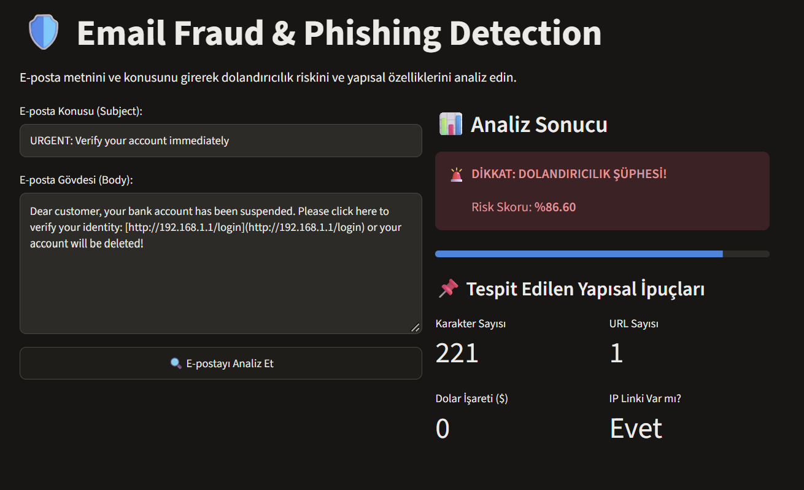
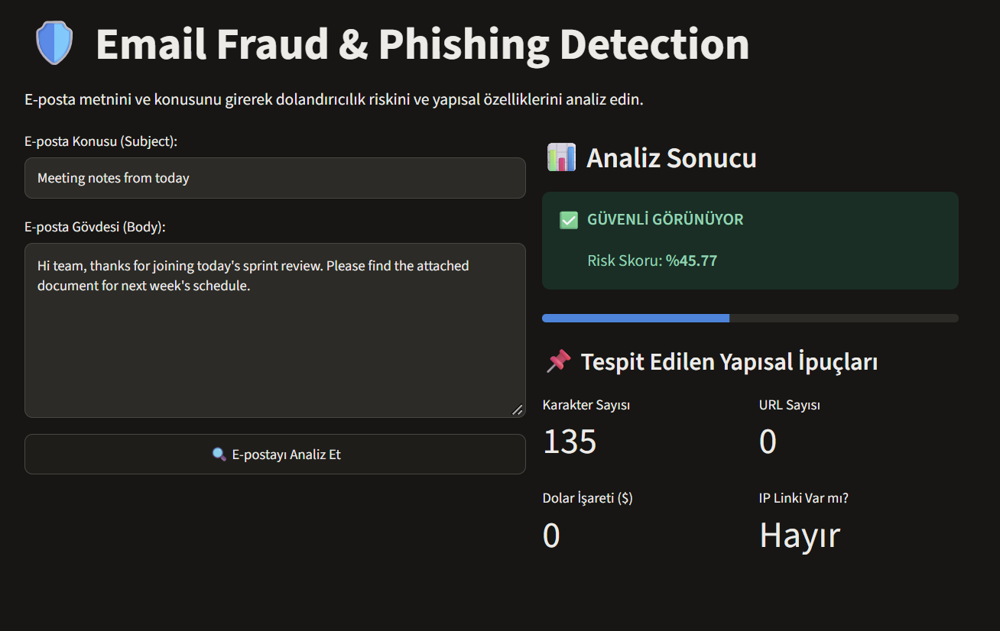

# End-to-End Email Fraud & Phishing Detection Pipeline

Bu proje, e-posta metinleri ve biçimsel meta-özellikler üzerinden oltalama (phishing) ve dolandırıcılık e-postalarını tespit eden uçtan uca makine öğrenmesi boru hattıdır.

## 🚀 Proje Özeti & Metodoloji

* **Veri Seti:** ~39.000 satırlık çok kaynaklı gerçek dünya e-posta veri seti (`naserabdullahalam/phishing-email-dataset`).
* **Temel Model:** TF-IDF n-gram (1,2) + Lojistik Regresyon (Baseline Accuracy: %99.41, ROC-AUC: 0.9996).
* **Hata Analizi (Error Analysis):** Modelin yanıldığı False Positive (normal e-postaya spam denmesi) ve False Negative (kaçırılan dolandırıcılıklar) vakaları incelenmiş; saldırganların sahte antivirüs damgaları ve IP içeren linkler kullandığı tespit edilmiştir.
* **Özellik Mühendisliği (Feature Engineering):** Metin tabanlı TF-IDF vektörlerine ek olarak; URL sayısı, IP adresi varlığı, büyük harf oranı, aciliyet bildiren semboller (`!`, `$`) ve karakter uzunluğu gibi 7 adet yapısal özellik çıkarılmıştır.
* **Sonuç:** Yapısal özelliklerin entegrasyonuyla test setindeki toplam hata sayısı 46'dan 39'a düşürülmüş (FP: 21, FN: 18), modelin dil manipülasyonlarına karşı gürbüzlüğü artırılmıştır.

## 🖥️ Streamlit Web Arayüzü & Canlı Demo

Uygulama; girilen e-posta metnini gerçek zamanlı analiz ederek dolandırıcılık riskini, güven skorunu ve metne ait yapısal meta-özellikleri görselleştirir.

  
  

* **Sol:** Şüpheli bağlantı ve aciliyet barındıran oltalama (phishing) e-postası tespiti.
* **Sağ:** Rutin iş akışı içeriğine sahip güvenli e-posta sınıflandırması.

## 📁 Proje Yapısı

├── assets/             # Web arayüzü ekran görüntüleri ve demo görselleri
├── data/               # Ham veri seti ü
├── models/             # Eğitilmiş model, TF-IDF vektörleştirici ve scaler bileşenleri (.joblib)
├── notebooks/          # Keşifçi veri analizi (EDA) ve hata analizi (01_baseline_model.ipynb)
├── src/                # Üretime hazır modüler kodlar
│   ├── __init__.py     # Modül tanımlayıcı
│   ├── preprocess.py   # Meta-özellik çıkarımı ve metin ön işleme fonksiyonları
│   ├── train.py        # Model eğitimi, metrik değerlendirmesi ve serileştirme
│   └── predict.py      # Canlı tahmin sınıfı (FraudPredictor inference engine)
├── app.py              # Streamlit tabanlı etkileşimli web uygulaması
├── .gitignore          # Depoya dahil edilmeyecek ortam ve veri kuralları
├── README.md           # Proje dokümantasyonu, mimari detaylar ve kullanım kılavuzu
└── requirements.txt    # Projenin çalışması için gereken Python bağımlılıkları